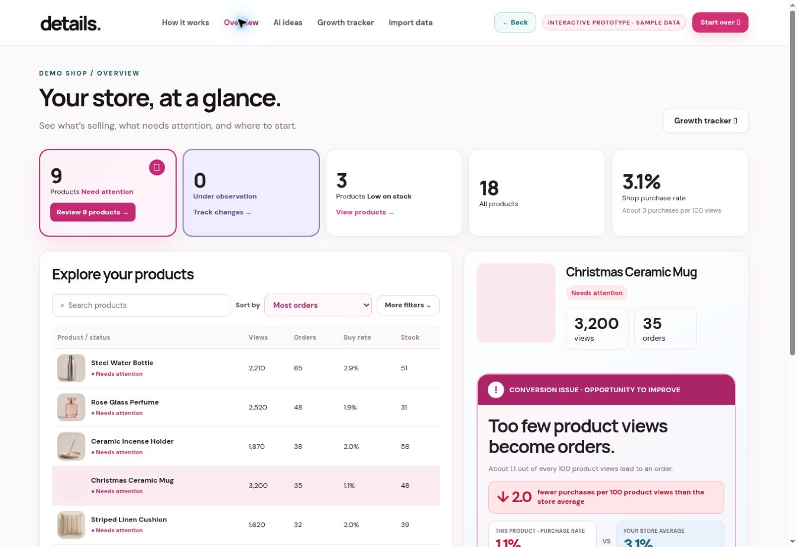
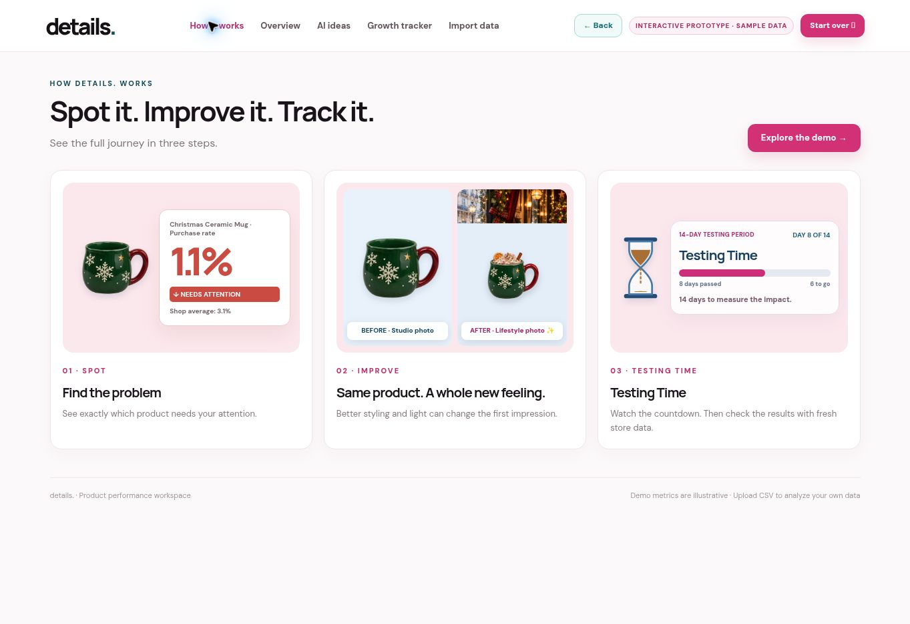
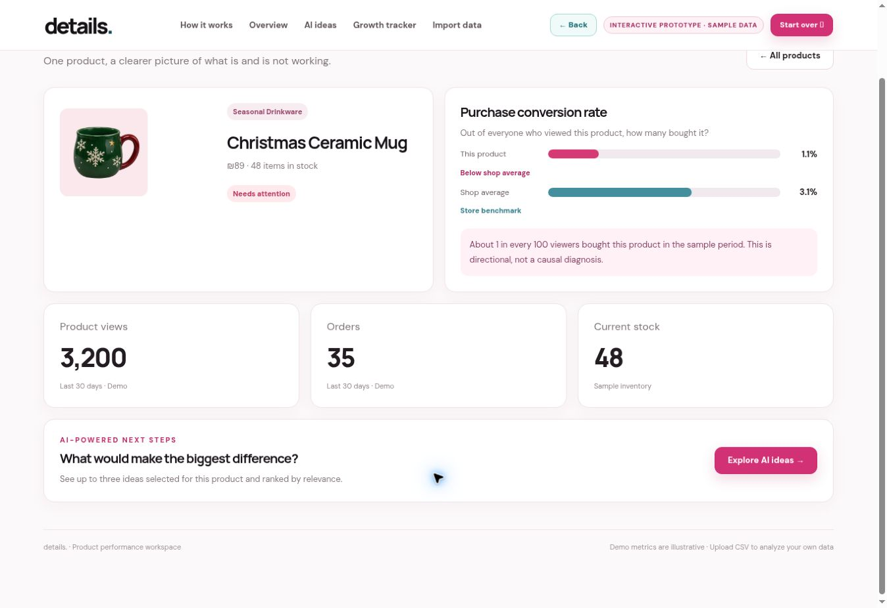
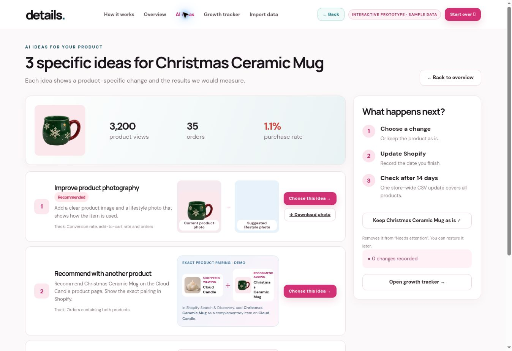
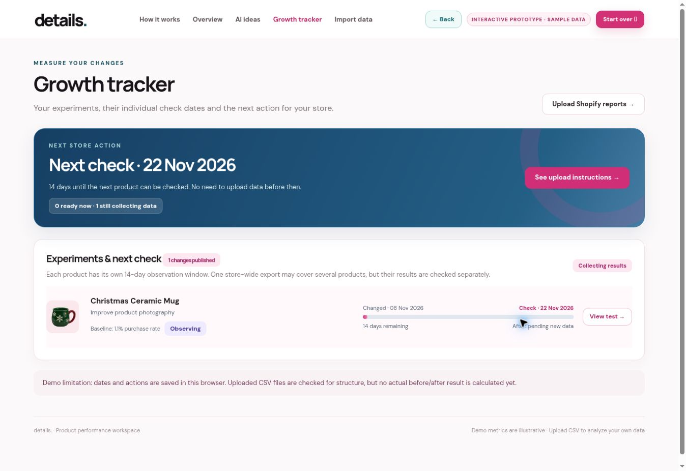

# details

**Product performance, with a next step.**

details. is a product analytics and growth experimentation workspace built around a simple question: **what should a small store owner improve next?**

It connects product views, orders and inventory, surfaces opportunities, suggests practical changes, and organizes a 14-day period to revisit results.

**[Explore the live demo](https://details-flow-inbar.builthedgehog.chatgpt.site)** · [Example CSVs](examples/)

## Run locally

Requires **Node.js 20+**. No installation of project dependencies, API key or Shopify account is needed.

1. Download or clone this repository and open its folder in a terminal.
2. Start the local server:

   ```bash
   npm run dev
   ```

3. Open **http://localhost:4173** and select **Explore the demo**.

To run the automated checks:

```bash
npm test
```



## Why I built it

The idea came from working with a small store in Tel Aviv. While helping with its website and automating parts of its day-to-day operations, I noticed how difficult it can be for independent business owners to turn their store data into useful decisions.

The information was there, but questions like *Which product needs attention? Why isn't it converting? What change should we try?* weren't easy to answer without digging through different reports.

I built **details.** to make that process more approachable: give owners a clear snapshot of each product, offer a concrete improvement to test, and make it easy to come back later and see whether the numbers moved.

The current version is intentionally CSV-first. It walks merchants through exporting their Shopify data step by step, and includes an interactive sample store so anyone can explore the experience immediately. A direct Shopify connection and model-backed recommendations are planned next steps; the code here uses explainable, rule-based recommendations.

## The problem

Store owners have data, but finding the next useful action often takes longer than it should. Product views, orders and inventory live in different reports. details. connects those signals into one product-centered workflow: **spot → improve → test**.



## What works

- **Instant demo:** Explore an illustrative 18-product catalog and the full workflow without connecting a store.
- **Local CSV analysis:** Import product, order and view reports. Validate headers and data, match product variants by handle/SKU/title, deduplicate order IDs, and calculate product-level and store-wide purchase rates.
- **Prioritized next steps:** Flag low inventory, underperforming conversion and missing data. Offer three rule-based, product-aware action ideas, plus practical Shopify implementation steps.
- **Experiment timeline:** Mark a change as published, save its baseline and schedule an individual 14-day check. Several products can share a follow-up CSV upload.
- **Follow-up groundwork:** The analytics engine includes calculations for dated follow-up reports and directional before/after comparisons. The current UI schedules checks and tracks actions; it does not yet display a calculated post-test result.
- **Responsive presentation:** Mobile-ready cards, navigation, comparison imagery and accessible labels, with product imagery preserving its aspect ratio.

## Tech stack

| Area | Technologies & implementation |
| --- | --- |
| **Frontend** | HTML5, CSS3, modern vanilla JavaScript (ES6+), DOM-based components and event-driven interactions |
| **UI engineering** | Responsive CSS Grid and Flexbox layouts, mobile navigation, fluid typography, accessible labels, image aspect-ratio handling, CSS animations |
| **Data processing** | Dependency-free CSV parser (quoted fields, escaped quotes and UTF-8 BOM), schema/column validation, type coercion and input error reporting |
| **Analytics** | Product normalization and matching by Shopify handle, SKU and title; variant aggregation; unique-order deduplication; purchase-rate and store-benchmark calculations |
| **Experiment logic** | Product-level action states, 14-day observation windows, baseline snapshots and reusable directional follow-up calculations in the analytics engine |
| **Client-side state** | Browser `localStorage` for experiment notes and calculated snapshots; in-memory file handling for imports |
| **Architecture** | Framework-free static application with a separate, reusable pure-JavaScript analytics engine (`dist/engine.js`) |
| **Testing** | Node.js built-in `node:test` and `assert`, automated edge-case tests and manual browser checks |
| **Developer tooling** | Node.js 20+, npm scripts, Git, a zero-dependency HTTP development server and static web hosting |
| **Commerce input** | Shopify CSV exports. OAuth/API integration is a planned extension, **not** part of this release. |

I kept the core analytics independent from the UI so matching rules, calculations and observation logic can be tested in isolation. There is no external AI API or background service in this version; recommendations are deterministic and inspectable.

## Product walkthrough

1. **Spot:** Import your own store reports or explore the sample catalog. Identify products with weak conversion, low stock or insufficient data.
2. **Improve:** Review three focused suggestions for a product and follow the implementation checklist in Shopify. Record when the change goes live.
3. **Test:** Let the change run for 14 days. The tracker records your baseline and follow-up date; calculating and displaying post-test results in the UI is a next step.

<table>
  <tr><td></td><td></td></tr>
  <tr><td align="center"><sub>Product-level insights</sub></td><td align="center"><sub>Ideas to test</sub></td></tr>
</table>



## Try a real import

1. Open **Import data**.
2. Upload `examples/products.csv`, `examples/orders.csv` and `examples/product-views.csv` in that order.
3. Explore the calculated catalog in **Overview**. You can switch back to the sample demo from the footer.

The importer accepts common Shopify export columns and explicitly reports missing or unsupported fields. Product views require a separate analytics export; Shopify report availability varies by store and plan. Files are processed **in the browser** and are not uploaded to a server.

## Architecture

```text
dist/index.html         Screens, CSS, navigation and browser state
dist/engine.js          Pure CSV parsing and analytics functions
dist/assets/            Original visual assets for the demo
tests/engine.test.cjs   Node built-in test runner
examples/               Non-sensitive sample input files
scripts/dev-server.cjs  Zero-dependency local server
```

The analysis engine is intentionally separate from the presentation. It makes the product matching and conversion logic testable without a browser or external services. The UI saves aggregated results and experiment notes in browser local storage; raw uploads are handled in memory.

**Purchase rate** = distinct non-cancelled orders containing a product ÷ matched product views × 100. This is a directional product-view-to-order proxy, not Shopify's official session conversion rate. Orders and views must cover comparable date ranges to make the number meaningful.

## Current scope

- **CSV-first prototype:** Analysis and experiment history run locally in the browser; direct Shopify sync is planned.
- **Explainable insights:** Suggestions are currently rule-based, and 14-day comparisons indicate trends rather than proving causation.

## Next engineering steps

The next production milestones are Shopify OAuth and automated sync, server-side import history, model-assisted suggestions with merchant approval, date-range completeness checks, and stronger experiment measurement.

---

**Built by Inbar Binyamin** · Product concept, UX and implementation.
